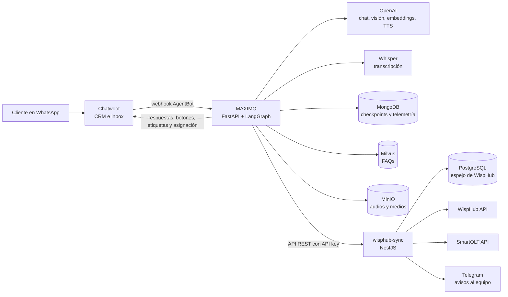

# MAXIMO — Agente de IA en producción para VEMAX Hogar

**Agente conversacional multi-agente (LangGraph) que atiende por WhatsApp a los clientes de VEMAX Hogar, un proveedor de internet por fibra óptica y cable en Lima, Perú, integrado a un CRM basado en Chatwoot.**

Autor: **Erick Palomino Valdivia**. Diseñé, programé, desplegué y opero el sistema de punta a punta.

> **El código fuente es privado**: pertenece a la operación del cliente y se conecta a sus sistemas de facturación y red.
> Este repositorio solo contiene documentación técnica y capturas con los datos de clientes difuminados. **Puedo agendar una demo en vivo** para mostrar el sistema funcionando y recorrer el código.
> Contacto: epalominovaldivia@gmail.com · [LinkedIn](https://www.linkedin.com/in/erick-palomino-valdivia-1b80b221a/)

---

## Resumen en 30 segundos

| | |
|---|---|
| **Qué es** | Un agente de WhatsApp que diagnostica averías, reinicia equipos de forma remota, registra pagos leyendo la foto del comprobante, otorga prórrogas, vende planes según la zona y, cuando hace falta, deriva a un asesor humano con el contexto del caso. |
| **Orquestación** | LangGraph: router determinista → classifier LLM → **4 agentes especialistas** (Soporte técnico, Pagos y facturación, Ventas, Mi servicio), cada uno con su prompt y su propio `ToolNode`, más un dispatcher para el menú. |
| **Herramientas** | 27 tools: WispHub (clientes, facturas, pagos, promesas de pago, tickets), SmartOLT (diagnóstico de ONU, reinicio y resincronización), validación de DNI, cobertura por zona, catálogo de planes y canales, búsqueda semántica de FAQs (Milvus) y derivación a humano. |
| **Multimodal** | Notas de voz (Whisper large-v3-turbo, con un "juez" LLM de inteligibilidad), lectura de comprobantes y fotos de equipos (GPT-4o Vision) y respuestas en audio (TTS) cuando el cliente las prefiere. |
| **Stack** | Python 3.11, LangGraph/LangChain, OpenAI, FastAPI, MongoDB (checkpointer y telemetría), Milvus, MinIO, Chatwoot, NestJS + PostgreSQL (backend de integración), Docker en un VPS propio. |
| **Calidad** | 44 archivos de tests con pytest (**707 casos**), sin llamadas de red; registro de tokens, costo en USD y diagnóstico de cada turno. |
| **Estado** | **En producción**, atiende a clientes reales todos los días. 3 062 conversaciones en Chatwoot, 1 671 en los últimos 30 días (al 12 de octubre de 2026). |

---

## 1. Problema

VEMAX atiende por WhatsApp tres tipos de consultas: averías ("no tengo internet"), pagos ("ya pagué, actívenme") y ventas ("¿llegan a mi zona?"). Todo se resolvía a mano: un asesor leía el chat, buscaba al cliente en **WispHub** (el sistema de gestión del ISP), revisaba la ONU en **SmartOLT**, verificaba el comprobante y respondía. Fuera de horario nadie atendía, y los casos simples (reiniciar un equipo, reactivar un servicio tras el pago) ocupaban casi todo el tiempo del equipo.

## 2. Arquitectura

- **MAXIMO (Python)**: recibe el webhook de Chatwoot, preprocesa los medios, ejecuta el grafo y devuelve texto, botones interactivos, adjuntos y eventos (etiquetas, derivación).
- **wisphub-sync (NestJS)**: backend que escribí para que el bot **nunca toque directamente** WispHub ni SmartOLT. Sincroniza clientes, facturas, planes, tickets e instalaciones en PostgreSQL (sincronización delta con cron) y expone endpoints `/bot/*` acotados: diagnóstico de la ONU, reinicio y resincronización, pagos reportados con deduplicación, promesa de pago, solicitudes de venta, asistencia humana y reportes técnicos.
- **Chatwoot**: bandeja omnicanal donde trabajan los asesores. El bot está registrado como AgentBot y se silencia en cuanto un humano toma la conversación.

Detalle en [docs/arquitectura.md](docs/arquitectura.md).

## 3. Datos y contexto

- **Estado tipado por conversación** (`TypedDict`, más de 80 campos): identidad del cliente (DNI, plan, estado del servicio), el dominio activo (`flujo_actual`), el paso de cada caso (`falla_paso`, `pago_paso`, `lead_paso`), los datos recolectados y los contadores de reintentos.
- **Memoria persistente por número de WhatsApp**: `thread_id` = número del cliente; un checkpointer propio sobre MongoDB (async) guarda el estado entre mensajes y días.
- **Ventana de contexto controlada**: solo mensajes del día, recorte por presupuesto de tokens (tiktoken), reparación de `tool_calls` huérfanos antes de llamar al modelo, y un bloque de "datos conocidos" inyectado en el prompt para no volver a pedir lo que el cliente ya dio.
- **Intención interpretada**: el classifier devuelve la categoría **y** una frase con la intención ya desambiguada ("cancelar el recibo" = pagar, en el español de Perú) que se pasa al especialista.
- **RAG**: FAQs del negocio en Milvus (embeddings de OpenAI) como respaldo; la cobertura y los canales usan coincidencia difusa sobre catálogos, porque la búsqueda vectorial no es fiable con nombres propios.

## 4. Herramientas (tools)

| Especialista | Tools principales |
|---|---|
| **Soporte técnico** | `clasificar_soporte_tecnico`, `reportar_falla_tecnica` (diagnóstico SmartOLT → reinicio → resincronización → reporte al equipo técnico), `consultar_ticket_soporte`, `preguntar_tipo_falla` |
| **Pagos y facturación** | `buscar_facturas`, `registrar_pago` (desde la foto del comprobante), `registrar_promesa_pago`, `solicitar_prorroga_pago`, `obtener_metodo_pago` |
| **Ventas** | `validar_cobertura_zona`, `preguntar_zona/localidad`, `presentar_planes_zona`, `mostrar_ficha_plan`, `consultar_reniec` (validación de DNI), `registrar_solicitud_ventas` |
| **Mi servicio** | `consultar_cliente`, `buscar_facturas`, `solicitar_cambio_plan`, `buscar_canal` |
| **Transversales** | `buscar_faq` (Milvus), `solicitar_asistencia_humana`, `cancelar_caso_actual`, `cambiar_formato_audio/texto`, `seleccionar_flujo_principal`, `mostrar_menu_principal` |

Cada especialista tiene **su propio ToolNode**: es estructuralmente imposible que un agente ejecute las tools de otro dominio.

## 5. Decisiones: qué decide el LLM y qué decide el código

| Lo decide el LLM | Lo decide código determinista |
|---|---|
| A qué dominio pertenece el mensaje (classifier) | El enrutamiento cuando ya hay un caso activo y la respuesta coincide con el paso esperado (se salta el LLM) |
| Qué tool llamar y con qué argumentos | La validación de argumentos: formato de DNI, fechas, método de pago, existencia del cliente |
| Cómo redactar la respuesta | Las reglas de negocio: máximo 4 días de prórroga, enfriamiento de 25 días, 48 h de verificación con comprobante |
| La categoría de la falla a partir del relato | La secuencia de remediación (diagnóstico → reinicio → resincronización) y cuándo se agota |
| Si una imagen es un comprobante ya pagado o una pantalla previa al pago | Exigir fecha y hora de la operación para registrar un pago; la deduplicación por método y número de operación |
| Si una nota de voz es inteligible | Cuándo derivar: tras 3 intentos sin progreso, fuera de alcance o fuera de horario |

## 6. Guardrails

- **Confirmación explícita** antes de acciones con efecto real (reiniciar o resincronizar la ONU, cerrar una venta, cambiar de plan).
- **Pagos sin "pagos fantasma"**: sin foto del comprobante no hay registro; sin fecha y hora de la operación tampoco (en producción, 282 de 291 registros exitosos traían fecha, así que la regla casi no cuesta y corta el error de raíz). Deduplicación por `(método, número de operación)` en el backend.
- **Límite de reintentos**: 3 pasos sin avance → derivación automática a un asesor con el caso resumido.
- **Doble verificación antes de derivar**: si un especialista quiere pasar el caso a un humano, el classifier lo contrasta; si lo ubica en un dominio de negocio, se reintenta una sola vez con el especialista correcto.
- **Redes de seguridad deterministas**: `dominio_fallback` reenruta en el mismo turno cuando un agente rechaza un tema que no es suyo, y `faq_fallback` consulta las FAQs antes de responder "no sé".
- **Handoff limpio**: cuando un asesor escribe o se asigna la conversación, el bot se silencia; también hay una pausa manual (`bot_paused`) y control de ecos para no responderse a sí mismo.
- **Concurrencia y costo**: un lock por conversación serializa los turnos y un limitador de tokens por minuto propio evita los errores 429 de OpenAI ante ráfagas.
- **Casos abandonados**: si el cliente vuelve tras 30 minutos (remediación en curso) o 1 hora, el bot retoma el caso con un resumen o lo cancela si el cliente cambió de tema.

Detalle en [docs/guardrails-y-evaluacion.md](docs/guardrails-y-evaluacion.md).

## 7. Despliegue

Docker Compose en **infraestructura propia** (VPS administrado por mí, sin nube pública): contenedor del bot (uvicorn con un solo proceso, a propósito, por el lock en memoria) y Redis; MongoDB, Milvus, MinIO y Chatwoot (Rails + Sidekiq) como servicios aparte. El backend NestJS corre en dos contenedores (API y worker de crons). Detalle en [docs/despliegue.md](docs/despliegue.md).

## 8. Evaluación y observabilidad

- **707 tests de pytest en 44 archivos**: classifier, router, cada especialista, cada tool, fallbacks, reintentos, *standby*, webhook de Chatwoot, medios, reintentos HTTP, presupuesto de tokens y limitador TPM. Ningún test llama a OpenAI (hay un stub automático en `conftest`).
- **Regresión sobre conversaciones reales**: cada bug de producción se reproduce con el hilo original y se valida repitiendo la llamada 5 veces (por ejemplo, de 0/5 a 5/5 aciertos tras inyectar la intención interpretada).
- **Telemetría por turno en MongoDB**: tokens de entrada, salida y caché, número de llamadas, **costo en USD** con precios por modelo, y un documento de diagnóstico con cada tool llamada, sus argumentos, el resultado y una alerta automática de "tool saltada".
- **Scripts de medición**: latencia del classifier, consumo TPM real y visor de conversaciones.

## 9. Resultado

- Funciona en producción y atiende a clientes reales todos los días, las 24 horas; fuera del horario de atención avisa cuándo responderá un asesor.
- Resuelve sin intervención humana los casos repetitivos: reinicio y resincronización remota de la ONU, detección de averías generales, registro de pagos con reactivación del servicio, prórrogas y precalificación de ventas por zona.
- Los asesores reciben en Chatwoot conversaciones ya **etiquetadas** (soporte, pago reportado, falla escalada, cambio de plan, agente) y con el contexto listo.
- Unos 116 commits en el bot y 52 en el backend entre junio y octubre de 2026, con documentación de diseño por módulo (*Spec-Driven Development*).

---

## Qué existía antes, qué hice yo y qué llegó a producción

| | |
|---|---|
| **Existía antes** | WispHub (gestión de clientes y facturación del ISP), SmartOLT (gestión de la red de fibra) y el WhatsApp del negocio atendido a mano. |
| **Diseñé y programé yo** | Los requisitos con el negocio, la arquitectura, el grafo LangGraph con sus 4 especialistas, el classifier y los fallbacks, las 27 tools, el procesamiento de audio e imágenes, el backend NestJS de integración (sincronización de WispHub, endpoints del bot, SmartOLT y Telegram), la instalación y personalización de Chatwoot (fork propio con AgentBot, etiquetas, avisos a los asesores, panel de actividad por etiqueta, desempeño por agente y atribución de anuncios de WhatsApp), la suite de tests, la telemetría de costos y el despliegue con Docker. |
| **Llegó a producción** | Todo lo anterior. El bot atiende a diario el WhatsApp de VEMAX y los asesores trabajan sobre Chatwoot. |

## Documentación

- [Arquitectura](docs/arquitectura.md): diagrama del grafo y de los componentes
- [Flujos](docs/flujos.md): soporte, pagos, ventas y mi servicio
- [Guardrails y evaluación](docs/guardrails-y-evaluacion.md)
- [Despliegue](docs/despliegue.md)
- [CRM en Chatwoot](docs/crm-chatwoot.md)

## Capturas (datos de clientes difuminados)

| Soporte técnico | Pago reportado |
|---|---|
|  |  |

