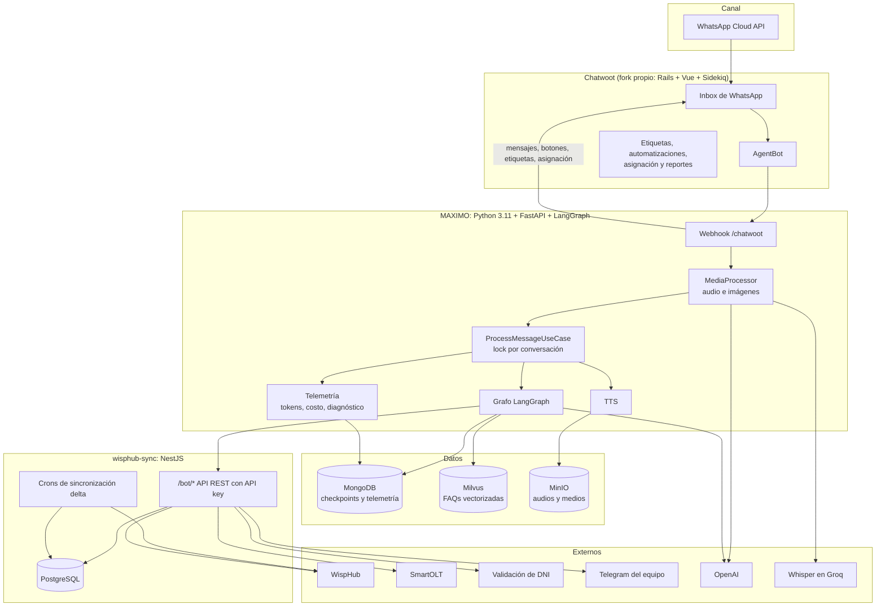
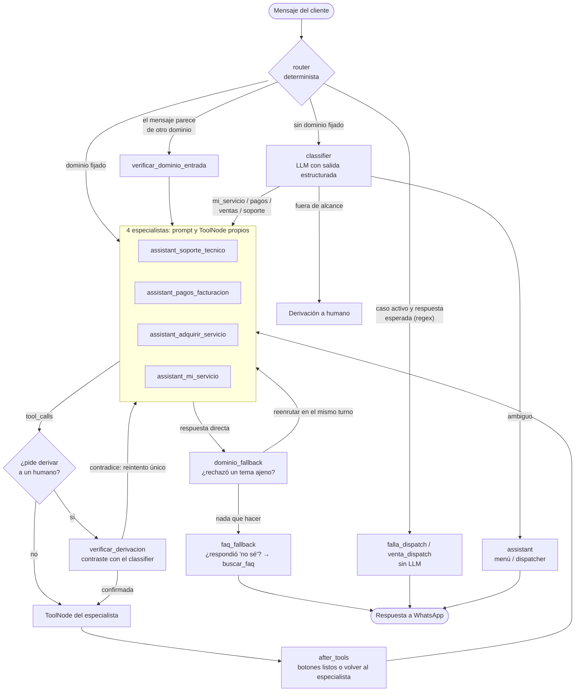

# Arquitectura

[← Volver al README](../README.md)

## 1. Componentes del sistema

### Por qué un backend intermedio (wisphub-sync)

- El LLM nunca recibe credenciales de WispHub ni de SmartOLT: solo puede llamar a endpoints acotados por DNI (`/bot/clientes/{dni}/diagnostico`, `/onu/reboot`, `/onu/resync`, `/bot/pagos`, `/bot/promesa-pago`, `/bot/solicitudes-ventas`, `/bot/asistencia-humana`...).
- Las lecturas frecuentes (cliente, facturas, plan) salen de PostgreSQL, sincronizado con WispHub mediante cron y sincronización delta (solo trae lo modificado desde la última corrida). Así la latencia baja y la API de WispHub no se satura.
- Las escrituras (pagos, promesas de pago) aplican sus reglas en el backend: deduplicación por `(método, número de operación)` con respuesta 409 y unicidad de la promesa por factura.

## 2. El grafo (LangGraph)

### Decisiones de diseño

1. **Un ToolNode por especialista.** En una versión anterior todos los nodos compartían un ToolNode armado con la lista general, y las tools propias de soporte técnico nunca se ejecutaban. Separarlos hace imposible repetir ese error.
2. **Camino rápido sin LLM.** Cuando hay un caso en curso y el cliente responde lo esperado (un DNI, un "sí" de confirmación, una foto), el router despacha directo a la tool. Ahorra tokens y latencia y elimina la variabilidad del modelo en los pasos mecánicos.
3. **Classifier en cascada.** Un modelo económico confirma los cambios de dominio que detecta el regex; solo si discrepa se consulta a un modelo de razonamiento más caro. El classifier fija `flujo_actual` para toda la conversación, por eso ahí se prioriza la precisión.
4. **Command en lugar de aristas estáticas** en los nodos de seguridad (`dominio_fallback`, `faq_fallback`, verificaciones): mezclar aristas estáticas con `Command` dinámico desde el mismo nodo genera dos continuaciones en el mismo *superstep*.
5. **Standby y retomada.** Si el cliente cambia de tema a mitad de un caso, el caso queda en espera y se retoma con un resumen de los datos ya capturados.

## 3. Ciclo de un turno

1. Chatwoot envía `message_created` al webhook del AgentBot.
2. Se descartan ecos del propio bot y notas privadas, y se ignora la conversación si tiene un asesor asignado o `bot_paused`.
3. Si un asesor humano escribió, se guarda su mensaje en el historial (para que el bot sepa qué se resolvió) y se le asigna la conversación.
4. Audio → transcripción con Whisper + juez de inteligibilidad. Imagen → descripción estructurada con visión (tipo de imagen y cada campo del comprobante).
5. `ProcessMessageUseCase` toma el lock de la conversación, aplica el limitador de tokens por minuto y ejecuta el grafo con el checkpoint de MongoDB.
6. La respuesta sale como texto, botones interactivos (hasta 3 *quick replies* o una lista de hasta 10 filas), adjuntos o audio TTS. Para ahorrar mensajes cobrados por Meta, el texto puede ir como *caption* de la imagen.
7. Se aplican etiquetas, se asigna a un asesor si corresponde y se registran el costo y el diagnóstico del turno.

## 4. Modelos

| Uso | Modelo |
|---|---|
| Especialistas y dispatcher | OpenAI GPT-4o / GPT-4o-mini (configurable), `temperature=0` |
| Classifier | Cascada: modelo económico → modelo de razonamiento solo si discrepan |
| Imágenes (comprobantes y fotos de equipos) | GPT-4o Vision |
| Audio entrante | Whisper large-v3-turbo (Groq) + juez LLM de inteligibilidad |
| Audio saliente | OpenAI TTS |
| Embeddings de FAQs | OpenAI embeddings → Milvus |

El diseño no depende del proveedor: los nodos usan las abstracciones de LangChain, así que cambiar a otro proveedor (por ejemplo, Amazon Bedrock) se limita a la fábrica del modelo y a la tabla de precios de la telemetría.
