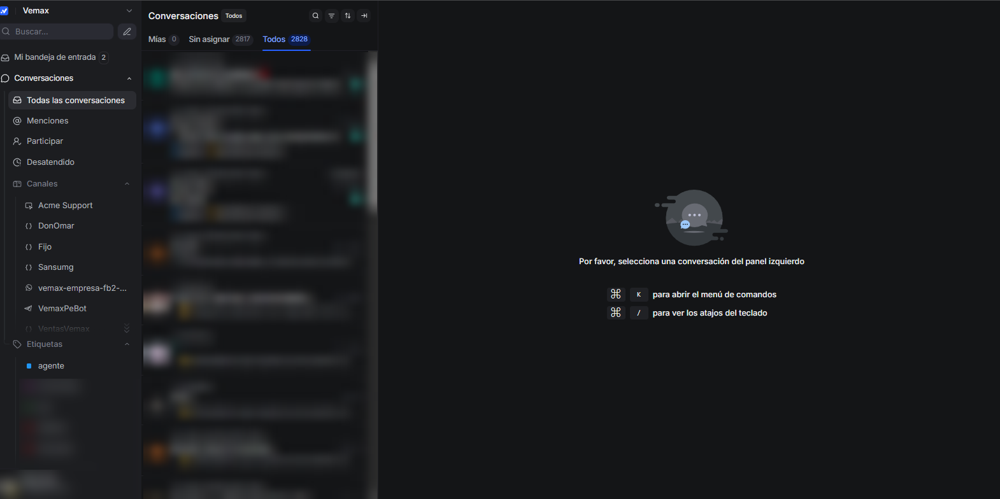
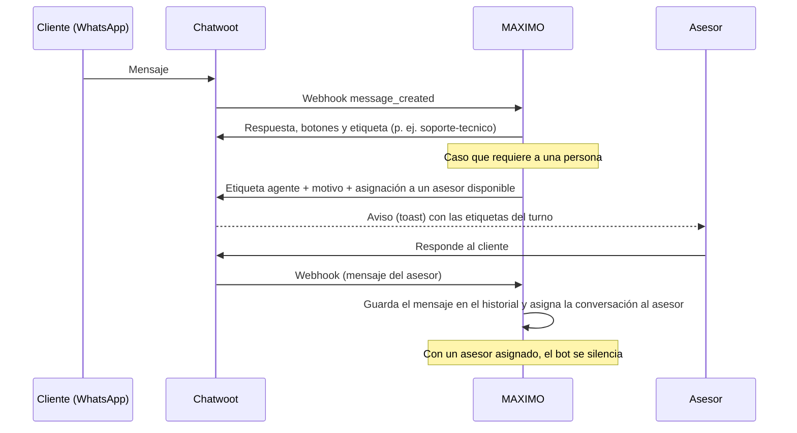
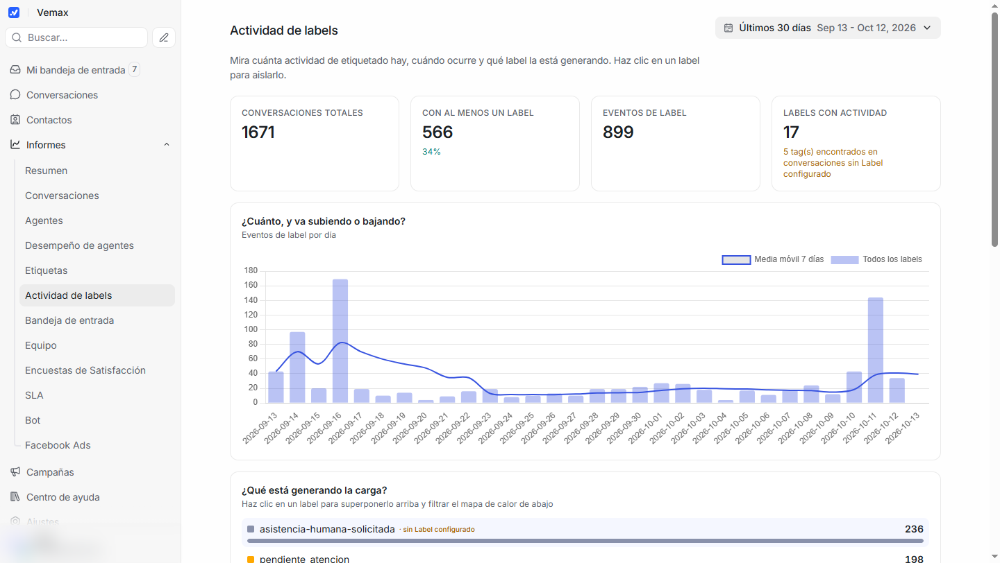
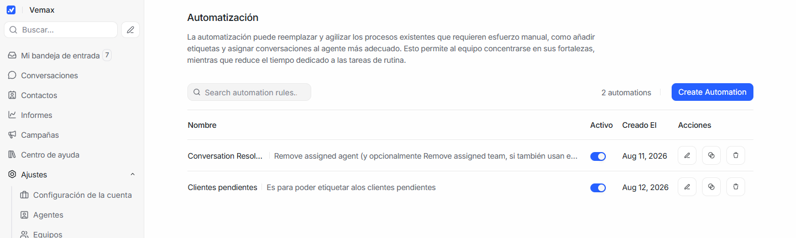
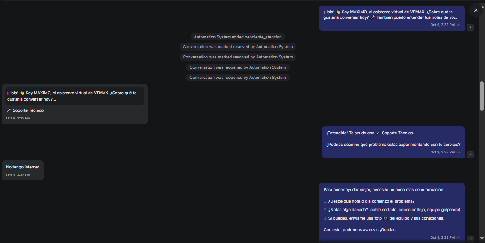
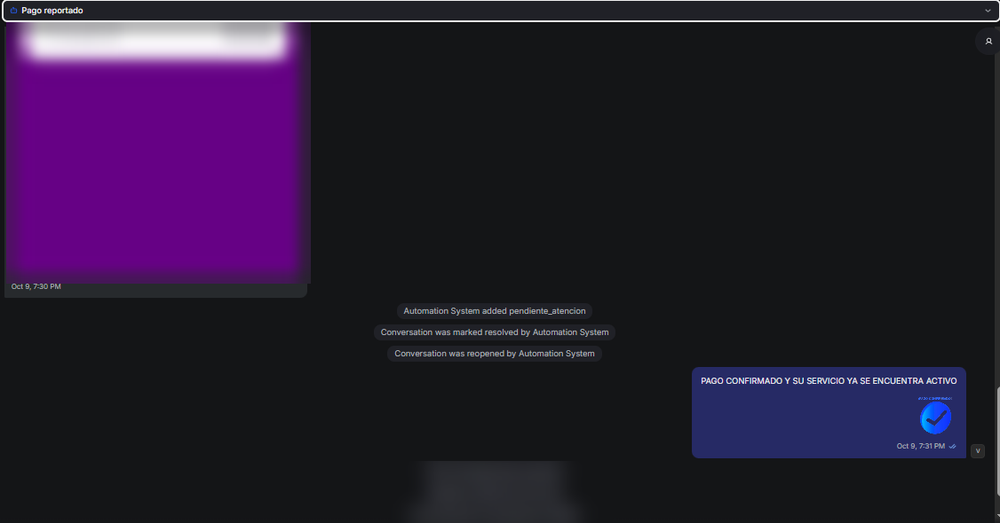

# CRM en Chatwoot

[← Volver al README](../README.md)

Chatwoot es la bandeja donde trabajan los asesores de VEMAX. Uso un **fork propio** (Rails + Vue) con personalizaciones para la operación del ISP. El bot se integra como **AgentBot**: recibe cada mensaje por webhook y responde por la API, así que sus mensajes quedan atribuidos al bot y no se confunden con los de un asesor.

*Bandeja de conversaciones. La lista de conversaciones y los nombres de personas están difuminados.*

## La cuenta en cifras (consultado el 12 de octubre de 2026)

| | |
|---|---|
| Conversaciones totales | **3 062** |
| Conversaciones en los últimos 30 días | **1 671** (566 con al menos una etiqueta, 899 eventos de etiqueta) |
| Asesores | 12 |
| Canales (inboxes) | 8: dos de WhatsApp Cloud API, Telegram, widget web y canales API para integraciones |
| AgentBot | 1, de tipo webhook, conectado a MAXIMO |
| Reglas de automatización activas | 2 |

## Cómo colaboran el bot y los asesores

- **Asignación**: al derivar, el bot pide a Chatwoot la autoasignación a un asesor disponible y avisa al equipo por Telegram. El mensaje al cliente ya tiene en cuenta el horario de atención, y el resultado de la asignación se muestra a los asesores como aviso; así se evitan mensajes extra, que Meta cobra.
- **Pausa manual**: el atributo `bot_paused` de la conversación apaga el bot sin desasignarlo.
- **Contexto para el asesor**: el motivo de la derivación y el resumen del caso (DNI, falla, pasos ya intentados, datos del pago) viajan con la derivación y quedan registrados en el backend (`/bot/asistencia-humana`), con un resumen diario para el equipo.

## Etiquetas que pone el bot

| Etiqueta | Cuándo |
|---|---|
| `soporte-tecnico` | El cliente entra al flujo de soporte (una sola vez por conversación) |
| `agente` | En el turno se derivó a una persona |
| `asistencia-humana-solicitada` | Pedido explícito de asesor, tema fuera de alcance o solicitud de baja |
| `falla-tecnica-escalada` | Remediación remota agotada; se envió un reporte técnico |
| `falla-tecnica-averia-general` | Avería general detectada en la zona del cliente |
| `pago-en-verificacion-sin-servicio` | Pago ya reportado, pero el cliente sigue sin servicio: requiere conciliación manual |
| `cambio-plan-solicitado` | Solicitud de cambio de plan confirmada |
| `pago-reportado` | Pago registrado desde el comprobante |

El equipo también usa etiquetas propias para su operación: `ventas`, `posible_venta`, `lead-registrado`, `no_hay_cobertura`, `pendiente_atencion` y una etiqueta de venta por asesor (`venta_<asesor>`) para atribuir cada cierre.

El mecanismo es genérico: cualquier tool que emita un evento con un subtipo nuevo crea su etiqueta sin tocar el código del webhook.

## Personalizaciones del fork de Chatwoot

- **Avisos (toasts)** en la interfaz cuando el bot etiqueta o deriva una conversación.
- **Panel de actividad por etiqueta** y **desempeño por agente** (detalle por asesor, tiempo de conexión y tiempo de atención en la hora de Lima).
- **Atribución de anuncios Click-to-WhatsApp** por clic.
- **DNI y coordenadas GPS** editables en el perfil del contacto (sirven para soporte y para las visitas técnicas).
- **Registro de averías** con evidencias.
- Correcciones de reportes y de atribución de resoluciones cuando una automatización desasigna al resolver.

## Panel de actividad por etiqueta (desarrollo propio)

Muestra cuántas conversaciones etiqueta el bot y el equipo, la tendencia diaria (con media móvil de 7 días) y qué etiqueta genera la carga. En la captura, la etiqueta más frecuente de los últimos 30 días es `asistencia-humana-solicitada` (236 eventos).

## Automatizaciones

| Regla | Evento | Acciones |
|---|---|---|
| Conversation Resolved | Conversación resuelta | Quita el asesor asignado y limpia etiquetas: el bot vuelve a atender al próximo mensaje |
| Clientes pendientes | Conversación actualizada (según su estado) | Agrega `pendiente_atencion`, resuelve o reabre y asigna asesor |

La primera regla cierra el ciclo con el bot: mientras haya un asesor asignado el bot no responde, y al resolver la conversación se libera para que MAXIMO vuelva a atender.

| Soporte técnico | Pago reportado y confirmado por el equipo |
|---|---|
|  |  |

*Comprobante, nombres y datos del cliente difuminados.*
