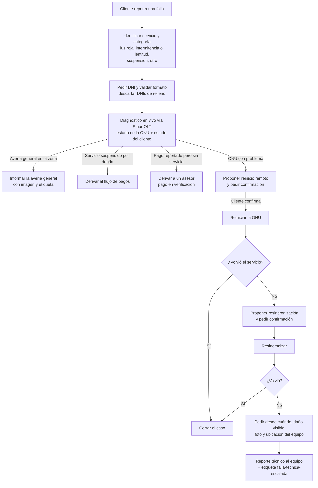
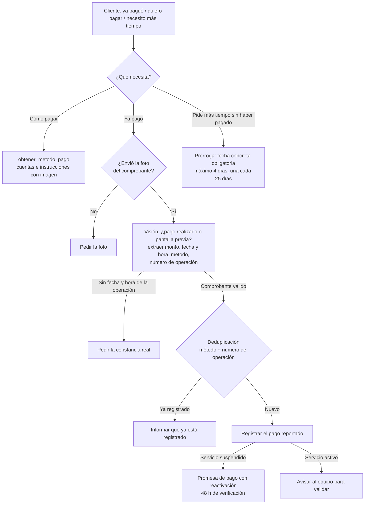
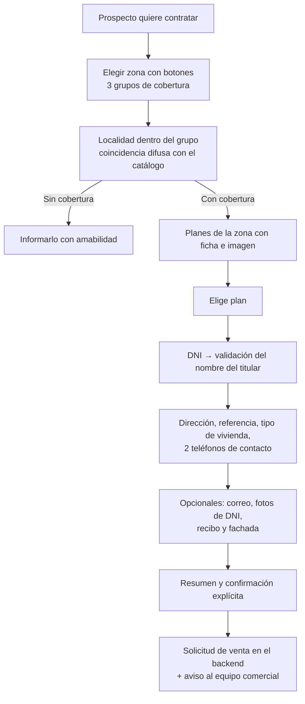

# Flujos de negocio

[← Volver al README](../README.md)

Todo empieza con un menú de bienvenida de 4 opciones (Mi servicio, Pagos y facturación, Contratar servicio, Soporte técnico). Si el cliente escribe directamente su problema ("hola, no tengo internet"), el classifier lo envía al especialista sin pasar por el menú.

## 1. Soporte técnico ("no tengo internet / no tengo cable")

Reglas en código:
- La remediación remota se marca como **agotada durante 24 h** por DNI: si el cliente vuelve a escribir, no se le hace reiniciar otra vez el equipo y se deriva directo.
- La categoría la infiere el LLM, pero si la omite hay un respaldo con expresiones regulares (por ejemplo, "pagué" → suspensión, "luz roja" → luz roja).
- Si el mismo paso se repite 3 veces sin avanzar, se deriva automáticamente.
- El cliente puede consultar el estado de un ticket con su número.

## 2. Pagos y facturación

Reglas en código:
- Sin foto no hay registro: se cortaron de raíz los "pagos fantasma", por ejemplo un "9k" sobre un televisor interpretado como un pago de S/ 9000.
- Fechas en hora de Perú, nunca en la hora del servidor.
- DNI inexistente: 3 intentos y luego se deriva a un asesor.
- Si el backend no responde al verificar duplicados, el registro sigue (*fail-open*) y se avisa al equipo: nunca se deja al cliente sin respuesta por una caída interna.

## 3. Ventas (contratar servicio)

- La cobertura y los canales usan catálogos con coincidencia difusa (difflib y normalización de acentos), no búsqueda vectorial: con nombres propios de zonas, los embeddings fallaban.
- Un sub-router determinista despacha los pasos mecánicos del formulario sin pasar por el LLM.

## 4. Mi servicio (clientes existentes)

- Consultar el plan, el estado del servicio y la fecha de corte con el DNI.
- Ver las facturas pendientes.
- Pedir un cambio de plan (subir o bajar): se confirma y se registra la solicitud con la etiqueta `cambio-plan-solicitado` para el asesor.
- Consultar la grilla de canales de cable (`buscar_canal`).

## 5. Transversales

- **FAQs**: `buscar_faq` sobre Milvus, y como último recurso automático antes de un "no sé".
- **Formato de respuesta**: el cliente puede pedir respuestas en audio (TTS) o volver a texto.
- **Cancelar el caso**: si hay un caso en curso, lo cancela; si no lo hay, se interpreta como una solicitud de baja y se deriva a una persona.
- **Asistencia humana**: en cualquier punto, con el motivo y un resumen del caso.
